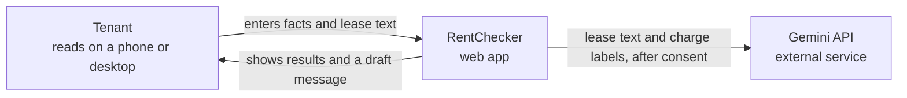
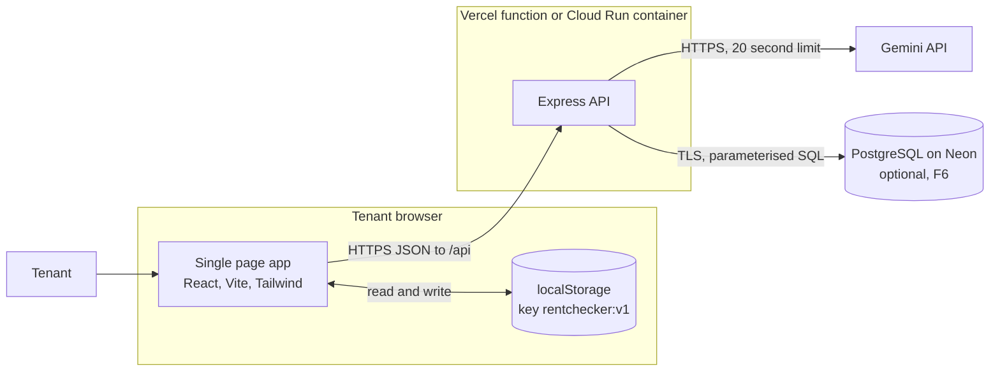
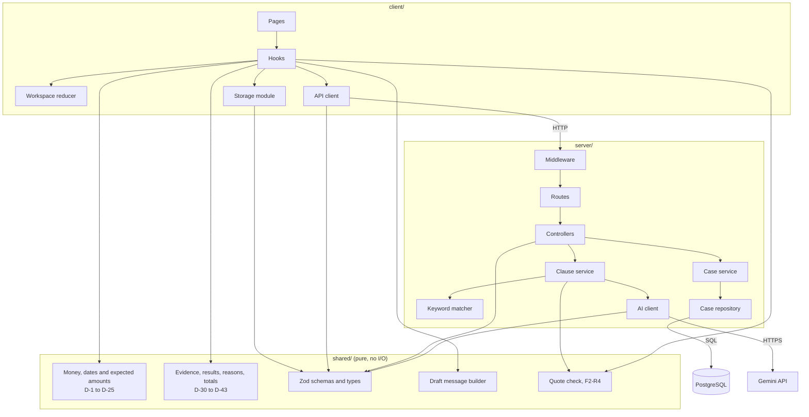
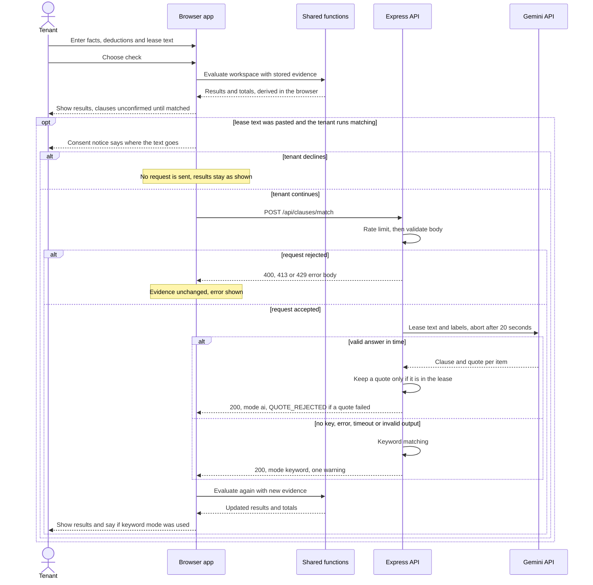

# Architecture

This file shows how RentChecker is split and how a check runs. Rules live in [DOMAIN_RULES.md](../spec/DOMAIN_RULES.md), requirements in [SRS.md](../spec/SRS.md) and routes in [API.md](API.md). Details per part: [FRONTEND.md](FRONTEND.md), [BACKEND.md](BACKEND.md), [DATA_MODEL.md](DATA_MODEL.md), [DEPLOYMENT.md](DEPLOYMENT.md).

## Level 1: system context



| Element | Role |
|---|---|
| Tenant | The only user. No login (SRS scope) |
| RentChecker | Checks deductions, keeps data in the browser |
| Gemini API | Suggests a clause and quote per item. It never calculates or decides a result (D-32 to D-36 are code) |

The landlord is not a user. The tenant sends the draft message outside the app (FR-13).

## Level 2: containers



| Element | Technology | Holds |
|---|---|---|
| Single page app | React, Vite, Tailwind, TypeScript strict | UI, the workspace reducer, all calculations through `shared/` |
| localStorage | Browser storage | The working copy of the whole workspace (ADR 0002) |
| Express API | Node.js, Express, Zod | Clause matching and cloud save. No state of its own |
| PostgreSQL | Neon, `pg` driver | Saved cases, only when the tenant turns cloud save on (ADR 0006). No lease text |
| Gemini API | Google | Nothing after the call. Prompt and response are not stored by RentChecker |

## Level 3: components



| Component | Responsibility |
|---|---|
| Pages, hooks | Screens, form handling, calling `shared/` to derive results |
| Workspace reducer | One state object for the whole workspace |
| Storage module | Load with validation, save, delete all |
| API client | One typed call with abort |
| shared/ | Everything in DOMAIN_RULES.md, the quote check, the Zod schemas for API.md and the workspace, the draft message |
| Middleware, routes, controllers | HTTP concerns, validation, status codes |
| Clause service | Chooses AI or keyword mode, checks quotes, builds the response |
| AI client | The only code that talks to Gemini |
| Case service, case repository | Recovery codes, revisions and expiry. The repository is the only code with SQL |

## Check deductions



A failed or slow AI call never blocks the calculations (NFR-3). Calculations need no network call (NFR-6).

## Folder tree

```text
RentChecker/
  api/index.ts            exports the Express app for Vercel
  client/                 React app (src/pages, components, hooks, state, storage, api)
  server/                 Express (src/app.ts, index.ts, routes, controllers, services, ai, middleware)
  db/migrations/          numbered SQL files
  shared/                 money, dates, calculations, results, totals, quote check, schemas, types, draft message
  docs/                   spec, design, adr, testing
  Dockerfile  vercel.json  .env.example  package.json  tsconfig.json
```

One root `package.json` serves all folders. Tests sit next to the code they test.

## Dependency rules

| From | May import | Must not import |
|---|---|---|
| client | shared, npm packages | server |
| server | shared, npm packages | client |
| shared | other shared files, Zod | client, server, Node or DOM APIs |
| api | server | client |

- shared does no I/O: no `fetch`, no `fs`, no `Date.now()`, no storage, no environment reads. Dates and clocks are passed in.
- Use relative imports, not path aliases, so the same files build in Vite, Vercel and Docker.
- Enforce with an ESLint import rule and by giving `shared` a tsconfig without DOM or Node types. Whether this setup works unchanged is not verified yet.
