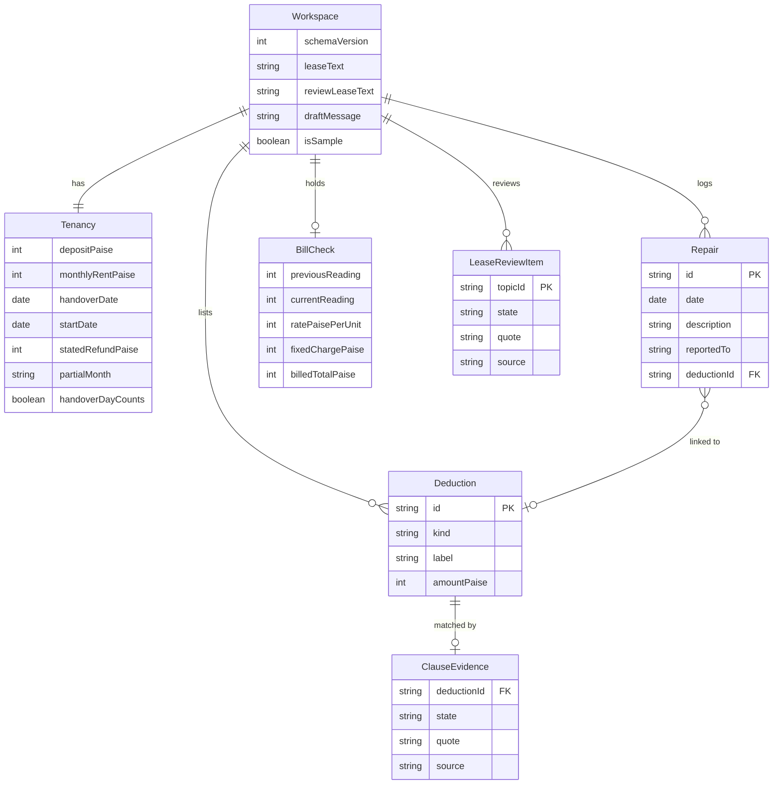
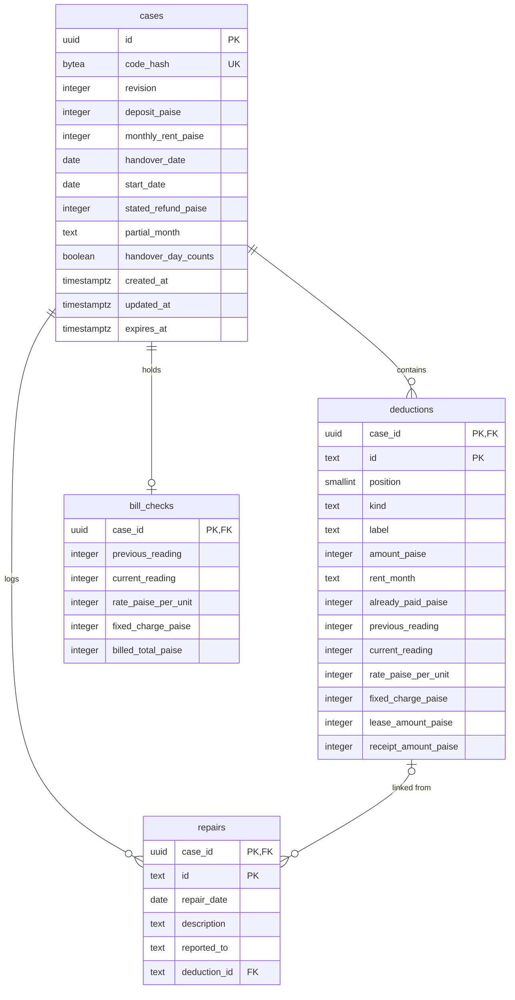

# Data model

The working copy is one JSON document in the browser (ADR 0002). An optional cloud copy is in PostgreSQL (ADR 0006), described at the end. Zod schemas for it live in `shared/` and are used to read it back. Rules for amounts and dates are D-1 to D-5 in [DOMAIN_RULES.md](../spec/DOMAIN_RULES.md).

## Logical model

## Rules for all entities

- Money is an integer number of paise (D-1). Names end in `Paise`.
- Dates are `YYYY-MM-DD` strings (D-5). A month is `YYYY-MM`.
- Readings are integers in hundredths of a unit (D-22).
- Ids are 1 to 40 characters of letters, digits, `-` or `_`, to fit API.md. `crypto.randomUUID()` meets this.
- Unknown fields are rejected when loading (`.strict()`).
- Results, reasons, totals, the refund gap and expected amounts are derived by `shared/` and never stored.

## Workspace

| Field | Type | Validation |
|---|---|---|
| `schemaVersion` | literal 1 | Must equal 1 |
| `tenancy` | Tenancy | Required, its fields may be absent |
| `leaseText` | string | Up to 40,000 characters. Empty means no lease |
| `deductions` | Deduction[] | At most 20 (FR-2) |
| `evidence` | ClauseEvidence[] | At most one per deduction |
| `repairs` | Repair[] | At most 50 (F5-R5) |
| `bill` | BillCheck, optional | One form, no history (F5) |
| `reviewLeaseText` | string | Separate from `leaseText` (F4) |
| `leaseReview` | LeaseReviewItem[] | At most one per topic |
| `draftMessage` | string, optional | The tenant's edited message (F3-R11) |
| `isSample` | boolean | True while the sample case is loaded (FR-7) |

## Tenancy

Every field is optional in storage, so a half-filled form survives a reload. F1-R3 says which are needed to run the check.

| Field | Type | Validation |
|---|---|---|
| `depositPaise` | int | More than 0, at most 1,000,000,000 (D-4) |
| `monthlyRentPaise` | int | Same |
| `handoverDate` | date | D-5 |
| `startDate` | date | Not after `handoverDate` (D-5) |
| `statedRefundPaise` | int | 0 up to the D-4 limit |
| `partialMonth` | enum | `unsure` (default, A-3), `per_day` or `full_month`. `full_month` triggers D-21, `unsure` triggers `ASSUMED_PER_DAY` |
| `handoverDayCounts` | boolean | Default true (A-4), used by D-20 |

## Deduction

A union on `kind` (D-10). Zod uses `z.discriminatedUnion("kind", ...)`.

| Field | Types and kinds | Validation |
|---|---|---|
| `id` | all | Unique in the workspace |
| `label` | all | 1 to 120 characters after trimming |
| `amountPaise` | all | More than 0, at most 1,000,000,000 (D-4) |
| `rentMonth` | `rent` | `YYYY-MM`, required |
| `alreadyPaidPaise` | `rent` | int, 0 or more, default 0 |
| `previousReading`, `currentReading` | `metered` | int hundredths, 0 to 1,000,000,000, optional. Current is not below previous (D-22) |
| `ratePaisePerUnit` | `metered` | int, 0 to 100,000 (D-22), optional |
| `fixedChargePaise` | `metered` | int, 0 or more, default 0 |
| `leaseAmountPaise` | `fixed_fee` | int, optional |
| `receiptAmountPaise` | `cost` | int, optional |

Optional means the user may leave it blank. Blank is stored as an absent key, which D-34 and D-35 read as missing.

## ClauseEvidence

| Field | Type | Validation |
|---|---|---|
| `deductionId` | string | Must match a deduction |
| `state` | enum | `verified`, `excludes`, `none`, `unconfirmed` (D-30) |
| `quote` | string or null | Not null only for `verified` and `excludes`. Not longer than `leaseText` |
| `source` | enum | `ai` or `keyword` (API.md), `user` for FR-11 overrides, `sample` for F1-R17 |

A deduction without a record is `unconfirmed`. Changing the lease text or a label removes the record, because the old match no longer applies. A match run does not change a record whose source is `user` (F2-R14).

## Repair

| Field | Type | Validation |
|---|---|---|
| `id` | string | Unique |
| `date` | date | Required |
| `description` | string | 1 to 120 characters after trimming |
| `reportedTo` | string | 1 to 120 characters after trimming |
| `deductionId` | string, optional | Must match a deduction. Used by `REPAIR_REPORTED` |

## BillCheck

Every field is optional in storage. F5 says which are needed to check the bill.

| Field | Type | Validation |
|---|---|---|
| `previousReading`, `currentReading` | int hundredths | Current is not below previous (D-22) |
| `ratePaisePerUnit`, `fixedChargePaise` | int | As for a metered deduction |
| `billedTotalPaise` | int | More than 0, at most 1,000,000,000 |

The expected amount comes from the D-22 formula and is derived.

## LeaseReviewItem

One per fixed deposit topic (FR-14). The topic list comes from the F4 feature file.

| Field | Type | Validation |
|---|---|---|
| `topicId` | string | An id from the shared topic list |
| `state`, `quote`, `source` | as ClauseEvidence | Same rules |

## Storage

Key `rentchecker:v1` holds the Workspace as JSON. `rentchecker:v1:corrupt` may hold the raw text of an unreadable value. Delete all removes both (FR-6). `rentchecker:cloud:v1` holds the recovery code, the last revision and the last save time (F6).

On load, the value is parsed, then checked with the shared schema. Failure and version rules are in [FRONTEND.md](FRONTEND.md).

| Case | Result |
|---|---|
| `schemaVersion` is 1 and the shape is valid | Loaded |
| `schemaVersion` is any other value | Not loaded, raw text kept under the `corrupt` key, no migration |
| Invalid JSON or invalid shape | Same as above |

The next change to the model that breaks old data raises `schemaVersion` and the key to `rentchecker:v2`. A migration is written only then.

## Cloud database (F6)

- A deduction is one of four disjoint kinds (D-10). They share one table. A check constraint per kind allows only the fields of that kind.
- `integer` is wide enough, because every amount and reading is at most 1,000,000,000 (D-4, D-22).
- `code_hash` is 32 bytes and unique. The recovery code itself is never stored.
- Child rows are deleted with their case. `repairs.deduction_id` must belong to the same case and becomes null when its deduction is deleted.
- `(case_id, position)` is unique and keeps the order the tenant entered.
- Limits on length, range and enum values in this file are also check constraints.
- `expires_at` has an index and is 365 days after the last save.
- Evidence, quotes, lease text, the review and the draft message have no column.
- Migrations are numbered SQL files in `db/migrations/`, run by one script that records which have been applied.
