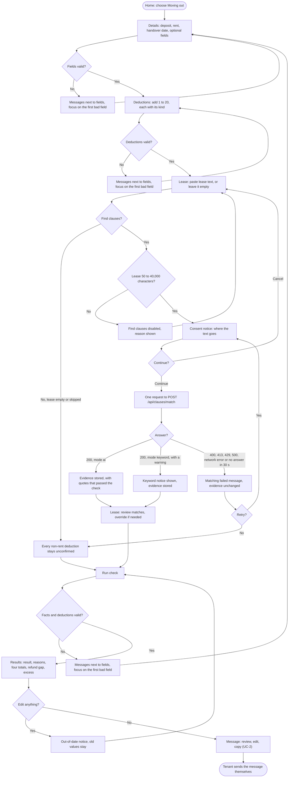
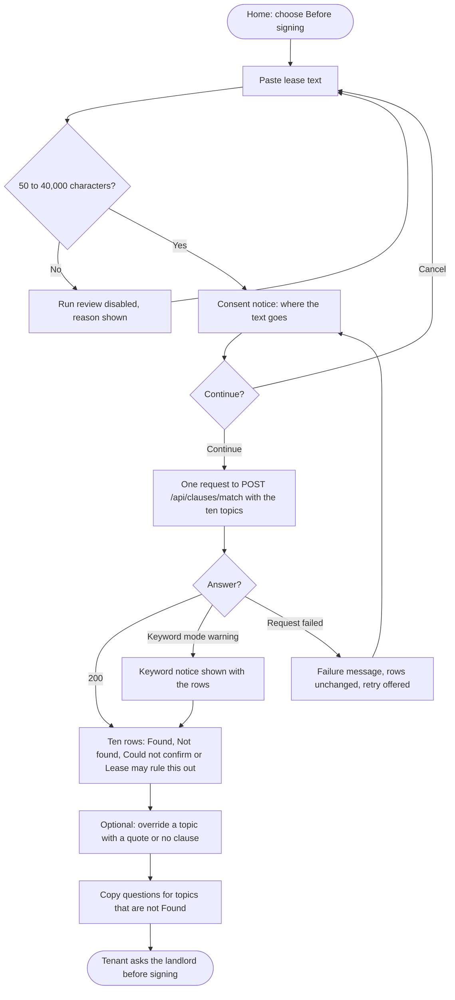
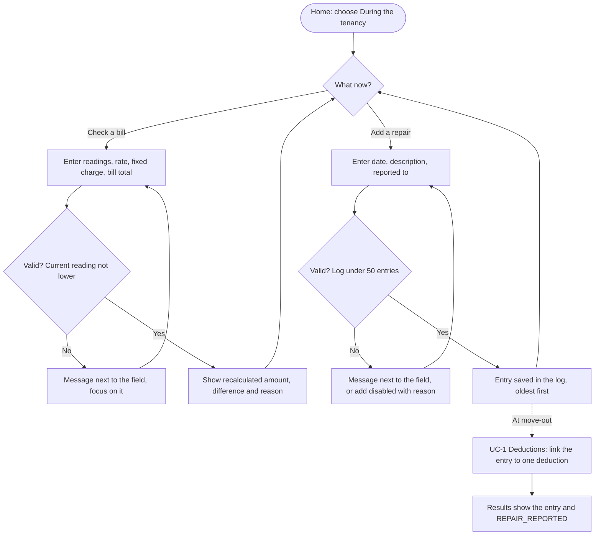
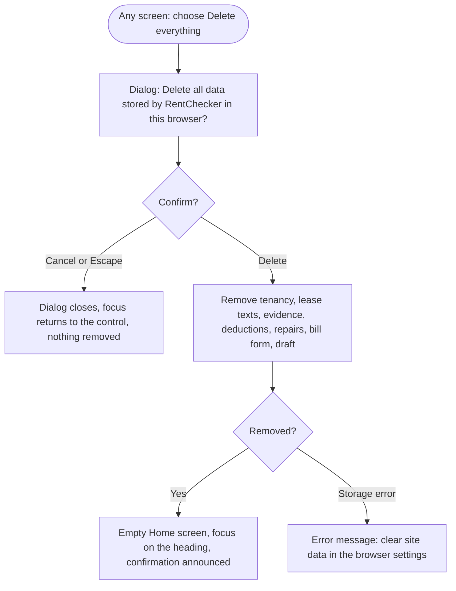

# User flows

These diagrams show the steps of each use case in [SRS.md](../spec/SRS.md). Screens and wording are in [UI.md](UI.md). Calculations run in the browser, and only the clause match uses the server (see [API.md](API.md)).

## UC-1 Check moving-out deductions

The tenant works through five steps: Details, Deductions, Lease, Results, Message. Next checks the fields of the step. The step list can open any step without checking. On a bad field the page shows a message next to the field and puts focus on the first bad field. Finding clauses is optional. If the AI is not available, the server answers in keyword mode and the flow goes on. If the request itself fails, the tenant can retry or run the check without clauses, because calculations never wait for the server (NFR-3). Rent deductions are not sent for matching (D-31). Results appear only after "Run check", and any later edit marks them out of date. The Message step is UC-2.

## UC-3 Review a lease before signing

The tenant pastes a lease and the app checks ten fixed deposit topics. This flow has its own lease text, separate from UC-1. The consent notice, the keyword mode and the failure handling are the same as in UC-1. Each topic ends as Found, Not found, Could not confirm or Lease may rule this out. The tenant copies the questions for every topic that is not Found.

## UC-4 and UC-5 Check a bill and keep a repair log

Both sit on one screen, During the tenancy. The bill check validates its fields and shows the recalculated amount, the difference and a reason. It saves no history. The repair log stores dated entries in the browser. Linking an entry to a deduction happens later, in the Deductions step of UC-1, and adds only the reason REPAIR_REPORTED. Deleting an entry removes its links and marks results out of date.

## UC-6 Delete everything

Available from the footer of every screen. The dialog names what happens and that it cannot be undone. Cancel changes nothing and returns focus to the control that opened the dialog. After a delete the app shows the empty Home screen and moves focus to its heading.

